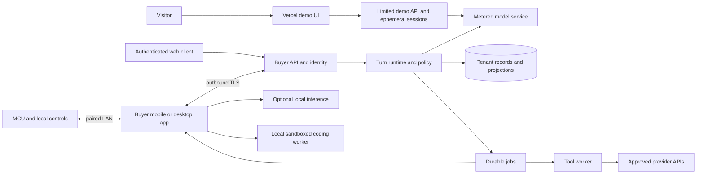

# Personal companion robot — master architecture and delivery roadmap

**24 November 2026.** The owner selected the US market, a USD 49–125 retail target, and an INR 2,000–3,000 monthly demo budget. Use INR 3,000 as the ceiling. The [R0 release record](COMPANION_R0_RELEASE.md) includes the scope, assumptions and first R1 acceptance checks.


The [local R1 visitor preview](R1_DESKTOP_COMPANION.md#try-the-visitor-preview) now demonstrates language switching, interruptible scripted replies and a visit-only project nickname. The next software milestone is the monthly spend ledger. Open-ended visitor inference, voice, waitlist and hosting remain separate release gates.

## 6. Voice, models, memory and training

**Listening to speaking.** Start with an explicit push-to-talk event. Bind consent to the audio provider and language. Run endpoint detection, show interim words as tentative and send only a final transcript unless the user edits it. Echo suppression, noise suppression and voice activity detection serve different purposes. Benchmark each separately with the speaker playing and motors running. For hands-free mode, perform wake detection locally first. Keep only a short volatile pre-roll, indicate active capture and provide a real hardware mute. Verify actual wake-word and language support on the chosen chip. Release pseudo-duplex first (button interrupts playback and starts capture). For full duplex, feed a playback reference into echo cancellation and test double-talk before enabling automatic barge-in.

**Inference candidates.** Use the current local Qwen configuration as a comparison. Evaluate two commercially usable multilingual open-weight instruction models behind the normalized adapter, one small quantized host model and one stronger hosted model. Record exact revision, license, quantization, prompt version and runtime. Test structured tool selection, supported context, Tamil and transliterated Tamil, correctness and time to first useful clause. Bench a multilingual Whisper-family recognizer locally on the bridge against a hosted Tamil recognizer. For synthesis, compare installed voices with a commercially licensed Tamil/Indian English neural TTS provider. Add a separate grant when text or audio leaves the host. Explicitly surface transcription, LLM, vision, embedding and TTS routes, which can have different providers and retention policies. Prefer a licensed original voice. [Local Whisper implementation](https://github.com/ggml-org/whisper.cpp) · [Browser speech recognition](https://developer.mozilla.org/en-US/docs/Web/API/SpeechRecognition) · [Local voice detection](https://developer.mozilla.org/en-US/docs/Web/API/SpeechSynthesisVoice/localService)

**Measurement plan.** Capture timestamps for speech end, final transcript, inference admission, first text, first synthesized sample, first audible sound, stop press and last audible sound. Use acoustic loopback for the last mile and monotonic timings where possible. Report p50/p95, timeout rate and sample count by device, language, network, cold/warm start and provider. Report transcription word/character error and exact names, dates, numbers and negations. Obtain human ratings for intelligibility, warmth, appropriate restraint and code switching. Proposed pilot targets for negotiation are warm speech-end to first audible reply p50 ≤2.5 s and p95 ≤5 s, and local acoustic Stop p95 ≤250 ms. Collect at least 30 measured turns per primary language and separate mixed/noisy tests. Label misses and compare before spending on dedicated capacity.

**Memory lifecycle.** Distinguish conversation history, sourced facts, semantic documents, permissions and temporary execution state. Example record: tenant ID, claim ID, subject, relationship, value, source event, confidence/evidence, validity window, sensitivity, authorized audiences, permitted processing routes, version and deletion state. Start with explicit “remember this.” Later propose inferred facts for review, especially relationships. Correct by superseding a version. Forget removes active claims and invalidates derived edges, embeddings, caches and exports under service control. Expose independent transcript retention and backup expiry. Reapply deletion records during restore before opening traffic. A device factory reset must give the buyer an explicit separate choice about deleting cloud account data. Multi-device conflicts use optimistic versions and a clear resolution UI.

**Fine-tuning experiment.** Keep personal memory outside model weights. First freeze a versioned prompt and examples. Inventory dataset source, duplication, consent and commercial redistribution/training rights. Quarantine fictional capabilities, private conversations, unlicensed movie lines and unsupported knowledge. Commission original Tamil/English examples with speaker and purpose permissions. Split by source, speaker and semantic cluster before training. Hold out code switching, distress, factuality, permission refusal, tool arguments and response formatting. Compare prompt-only against LoRA/QLoRA on a licensed base, then re-test the quantized deployment artifact. Track dataset hash, base revision, tokenizer, hyperparameters, seed, license and full evaluation. Ship an adapter only if blinded reviewers prefer it and privacy/tool/task metrics hold; retain the prompt baseline for rollback. Train a speech model only after measured acoustic failures justify the data and consent costs. [LoRA and adapter concepts](https://huggingface.co/docs/peft/main/en/conceptual_guides/lora)

## 7. Accounts, integrations and collaborative work

**Account boundary.** Add OIDC sign-in and server-issued short-lived sessions. Bind every resource to a tenant, including source events, relationships, embeddings, files, jobs, app grants, devices, audit entries, streamed deltas and exports. Take identity from verified credentials. Use tenant-scoped unique keys and foreign keys, a least-privileged DB role and tested Postgres row-level policies. Check on every read/write, vector query and worker claim. Browser caches use separate account namespaces and clear on logout. Port in-memory locks, rate counts and cancellation to shared coordination before adding API replicas. Migrate a copied SQLite fixture with conversation counts, claim provenance and deletion tests. Invite the owner to opt into any personal-data migration. [Postgres row security](https://www.postgresql.org/docs/current/ddl-rowsecurity.html)

**App integration contract.** Register each capability with input/output schema, principal, resource scope, read/write class, remote destination, privacy routes, grant expiry, approval requirements, retry semantics, idempotency key and audit formatter. Present separate controls for reading, drafting and sending. Use OAuth authorization code flow with PKCE where applicable, verified redirect URIs and state checks. Encrypt refresh tokens using a managed key, rotate/revoke, and keep tokens outside model prompts and device firmware. On disconnect cancel pending work, invalidate grants and explain separately what was already sent. External messages or documents cannot mint approvals.

| Requested app | First end-to-end use case | Boundary and gate |
|---|---|---|
| Drive and Gmail | Select one Drive file, summarize it, draft an email and review recipient/body before send. | Minimize scopes with a file picker. Review Gmail scopes and provider verification obligations before launch. Reject approval if attachment, recipient or content changes. [Drive scopes](https://developers.google.com/workspace/drive/api/guides/api-specific-auth) · [Gmail scopes](https://developers.google.com/workspace/gmail/api/auth/scopes) |
| Contacts | Choose a contact on the phone to address the draft. | Prefer OS contact picker for one record. Test withdrawn permission, duplicate names and shared family devices. |
| Internet | Read a public page with source and retrieval time. | Reuse bounded research gateway. Revalidate each redirect, restrict private addresses, enforce TLS/size limits, isolate malicious page instructions. |
| WhatsApp | Qualify a specific approved business messaging workflow. | Confirm account eligibility, opt-in, message policy and webhook verification for the intended market. Personal chat access is a separate feasibility question. [WhatsApp Business Platform](https://developers.facebook.com/docs/whatsapp/cloud-api/) |
| Instagram and Facebook | Pilot one supported professional account or Page operation with the owner's approval. | Build a capability matrix by account type and app-review status. Advertise only verified operations. [Meta Instagram guide](https://www.postman.com/meta/instagram/documentation/6yqw8pt/instagram-api) · [Facebook Pages API](https://developers.facebook.com/docs/pages-api/) |
| Claude Code and Codex | Desktop app sends a scoped brief to the user's installed agent and returns verified diffs/check evidence. | User chooses a repo and approves exact file disclosure and provider. Pass sandbox preflight. No personal tokens bundled or captured by robot. Test each supported OS and adapter independently. [Codex CLI](https://developers.openai.com/codex/cli/) · [Claude Code overview](https://code.claude.com/docs/en/overview) |

**Collaboration until completion.** Represent work as durable steps with dependencies and a human-readable acceptance test. Example: retrieve a selected issue → propose change → obtain repository disclosure approval → execute in isolated checkout → run named checks → present diff → request owner review. States include proposed, approved, queued, running, waiting for owner/device, verifying, completed, failed, interrupted and cancelled. Lease with heartbeat and attempt ID. Bound wall time, retries, tokens and spend. If the bridge sleeps, release execution capacity and show what must reconnect. Reconcile ambiguous writes using provider IDs before retrying. Persist evidence and unresolved failures. Completion requires the agreed result, and a failed test pauses for repair within the remaining budget. Pass one task ID between robot, web and desktop. Revocation and Stop propagate across participants.

## 8. Security, privacy and operations

| Failure or abuse | Design requirement | Release evidence |
|---|---|---|
| Public visitor reaches private data or exhausts paid inference | Separate demo deployment/store/service identity. Per-session and network quotas, global daily spend reservation, short sessions, concurrency caps, queue limits and kill switch. Minimize demo retention. | Exercise two visitors with the same prompt, guessed session IDs, reconnects, parallel requests and budget exhaustion. Verify no path to admin, tools, firmware or private history. |
| Buyer A reads B via search, cache or artifact | Enforce tenant ownership before retrieval and after ranking. Signed short-lived artifact URLs, scoped cache keys and stream authorization. | Two-account negative suite for search, export, guessed IDs, websocket/SSE reconnect, job events, device commands and logout/account switching. |
| Stolen or resold device | Unique key per unit, physical claim challenge, revocable credential, signed updates, secure boot and production debug policy. | Revoke offline device, rejoin, transfer ownership, verify former buyer cannot control or recover new data. Distinguish local wipe from cloud deletion. |
| Spoofed webhooks, instructions in mail/images or duplicate sends | Verify provider signatures/freshness, deduplicate IDs, treat retrieved content as data, bind approvals to exact action and destination. | Replay webhook, change recipient after approval, simulate timeout after provider accepted send. Verify exactly one known outcome or visible unknown state. |
| Media or model provider discloses sensitive information | Consent by modality/route, visible indicators, minimum retention, no raw media in routine telemetry, no fallback outside grants. | Disable cloud mid-turn, deny mic/camera permission, remove local voice, request erase and check projections and backups policy. |
| Robot behaves unsafely or becomes unreachable | Firmware-local stop/limits, short command TTL, power/watchdog checks, staged update and offline safe state. | Cut network and power during motion/update, test stale packets, held buttons, low voltage and thermal faults. |
| Deployment or supply-chain compromise | Separate dev/staging/prod, secret manager, scoped build identities, lockfiles, SBOM and artifact signing. Firmware signing keys are separate from API credentials. | Reproduce builds, rotate exposed secret, roll back backend/frontend/model and firmware independently, restore from encrypted backup. |

**Networking and deployment.** Proposed public topology uses Vercel for the Vite demo and a dedicated HTTPS streaming API on managed compute. Build only allowlisted demo sources into its artifact. Existing root `.vercelignore` excludes `frontend/`; a root import is not a demo release recipe. Use distinct production and preview domains and secrets. Prefer same-origin API proxying if streaming, buffering and timeouts pass a deployed test. Otherwise configure explicit allowed origin, cookie scope, CSRF tokens/origin validation and TLS. Verify SSE through actual CDN and reverse proxy with buffering disabled. Keep database, queue and worker control plane on private networks. Allow only known provider egress as needed. Bound requests at admission; load-test concurrent streams rather than equating page views with inference capacity. Keep local model ports on loopback. Remote bridges initiate authenticated outbound connections, so customers need no router port-forwarding.

**Maintenance.** Assign on-call ownership to platform, model, firmware and customer support even if one founder fills all roles. Trace anonymous correlation IDs, queue lag, provider failures, tokens/cost, speech-stage timings, battery resets, firmware cohorts and OTA failure rates. Redact tokens, prompts, media, precise contact data and file contents. Invite diagnostics only with consent and expiry. Monitor daily spend and error/latency by provider. Weekly triage failed jobs and device resets. Monthly test restore, rotation, dependency advisories and vendor deprecations. Before every release run migration rehearsal, smoke tests, compatibility matrix and rollback. Maintain a supported firmware/protocol window with a published end-of-support policy.

**Recovery runbooks.** Model outage → shed demo traffic, preserve typed draft, offer an eligible alternative with disclosure. Database outage → reject mutations, pause workers and resume after reconciliation. Device fleet incident → disable new motion plans, stop rollout, identify affected revisions, restore last-known-good version. Lost credential → revoke and re-pair with physical proof. Restore exercise → choose recovery point, rebuild disposable projections, replay deletions, compare tenant counts and verify two-account isolation before reopening. Proposed paid-beta recovery targets: at most 24 h of canonical data loss and 4 h to restore. Measure them and tighten before contractual commitments.

## 9. Implementation backlog and release gates

IDs below are new robot milestones. Legacy Phase 6 telephony moves behind the companion beta. Effort and dates depend on staffing, procurement, speech performance and provider review. Work packages end with observable evidence.

| ID and dependency | Tasks and accountable discipline | Exit evidence |
|---|---|---|
| R0 · baseline | Product/platform: lock demo audience, target price band, supported locales, privacy promise, account/retention boundaries and initial spend limit. Inventory redistributable assets, models and speech licenses. Capture desktop baseline and create synthetic fixtures. | One-page release scope, decision log, synthetic dataset, costs worksheet, local boot transcript and two tested scripts per language. |
| R1 · R0 | Web/backend: separate demo build and restricted API; temporary sessions, avatar display states, SSE Stop, bilingual voice/text, curated demo prompts, separate waitlist and consent. Configure quota reservations and fallback. | Fresh browser demo on phone and desktop. Two visitors isolated, Stop before first token works, cap rejects traffic predictably. Measure first audio, completion, return turns and waitlist opt-in without storing raw conversations for analytics. |
| R2 · R0, parallel with R1 | Embedded/mechanical: select two candidate boards, assemble USB bench unit, profile audio/display, implement physical mute, stop and simulated gateway. Bring up camera and gait on separate fixtures. | Video of real device listening, speaking, interrupting and showing offline state. BOM with measured current, thermal, SRAM/PSRAM and pin budgets. |
| R3 · R1 | Platform/security: OIDC, account-scoped Postgres, retention, device registry and enrollment, backups, tenant-aware tools/jobs and export/delete. | Alice/Bob tests across every channel; successful backup restore, account deletion and lost-device drill. |
| R4 · R2 + R3 | Bridge/audio: pair first desktop host, implement authenticated LAN transport and inference routing, signed updates, then mobile pairing/foreground limits. Test relay fallback, offline behavior and local model discovery. | Same buyer continues one conversation across web/desktop/robot; host sleep, reconnect and revocation verified. Physical end-to-end Tamil/English metrics captured. |
| R5 · R4 | Hardware/vision: fit motors/sensors and enclosure, validate gait/power, on-demand camera vision and physical indicators. | Production-intent prototype on intended surface. Stall, ledge, disconnect, physical stop, low battery, camera shutter and OTA interruption tests pass against signed test plan. |
| R6 · R3, can overlap R5 | Integration: approve file → summary → email draft → approved send. Add contacts, research and task progress. Release one provider/action at a time. | Link, revoke, reconnect, token expiry, duplicate callback, ambiguous send and account-switch drills. Accurate permissions screen and artifact history. |
| R7 · R4 + R6 | Agent engineering: solve Codex native sandbox blocker, add Claude Code adapter, durable bridge queue, bounded collaboration and human review. | Synthetic repository tasks finish with diff, check output, resource usage and untouched original. Cancel, restart and failed authorization tested for both adapters. |
| R8 · R1–R5 for advertised features | Manufacturing/operations: source alternates, prototype to engineering validation, design validation and pilot production. Manufacturing fixture flashes signed image, provisions unique keys, calibrates joints and tests radio/audio/camera/display. Document support, returns, replacement, repair, packaging and wipe. | Pilot yield and failure modes recorded per unit, firmware cohort rollback and support scripts verified, landed cost/margin and shipping assumptions reviewed. Obtain region-specific qualified review of applicable battery transport, electrical/radio, privacy and product obligations. |
| R9 · measured customer workloads | ML/product: test fine-tuning and local/hosted inference economics. Expand verified apps or phone calling only with demand and acceptance evidence. | Blind eval, rollback and versioned model card. Each newly advertised integration passes its own live account and revocation gate. |

**First executable sprint.** Open six tickets in order: (1) build synthetic visitor fixtures and an explicit demo feature allowlist; (2) implement a stand-alone demo session/create-turn/stop API with expiry; (3) connect the existing face/voice/Stop UI to it; (4) add rate/spend limits plus two-visitor tests; (5) benchmark two model/speech combinations in both languages; (6) deploy an isolated staging build and record one short demonstration. In parallel, an embedded engineer can build a USB-powered screen and button prototype driven by the same simulated events. Public waitlist can follow the software gate. Gate paid preorders on footage of the real prototype, known feature scope, priced BOM, manufacturing and fulfilment estimates, and clear refund/support terms.

## 10. Run, integration and release playbook

**Run the existing desktop baseline today** from the repository root on Windows. Setup assumes LM Studio CLI, the two models named by the launcher, Node/npm, and the parent virtual environment with compatible dependencies. On a clean checkout install the appropriate Python dependencies and run `npm --prefix frontend ci`. The lockfile is a Windows environment snapshot. Configure a private `.env` from `.env.example` only if missing, set a fresh server-side owner token and use loopback model endpoints. Never copy the developer's databases or secrets into a demo. Follow [Phase 1 setup](PHASE_1_SETUP.md) and [Phase 5 voice](PHASE_5_VOICE.md).

```powershell
# Local operator launch, including model loading and a single-use pairing link
.\scripts\start-local.ps1

# Deterministic checks, from the same project root
..\.venv\Scripts\python.exe -m pytest tests -q
npm --prefix frontend run test
npm --prefix frontend run typecheck
npm --prefix frontend run lint
npm --prefix frontend run build
```

Open localhost:8081 using the generated launch flow. Test text, Stop, a respectful preview in a separate session, Tamil/English transcript review and a local voice. Check server logs under ignored `.runtime/`. Verify recall, correction, forget and restart on synthetic data. The backend listens on loopback port 8000 and LM Studio uses 1234. See [memory guide](PHASE_2_MEMORY.md), [tool guide](PHASE_3_TOOLS.md) and [coding worker limitations](PHASE_4_CODING.md).

**Integrate a new component.** First define its capability, caller identity, data inputs and destinations, side effects, resource bounds, error states and Stop semantics. Implement a synthetic adapter on the consumer side and replay success/failure fixtures through the real entry point. Implement the real transport behind the same interface. Enforce grants and ownership outside the model. Verify missing permission, revocation during execution, interrupted/repeated requests, slow downstream service and privacy-aware fallback. Release behind a per-device/tenant feature flag. Document supported versions, observed latency, cost and rollback.

**Bring up firmware once R2 adds a board project.** Pin the board support package, schematic and ESP-IDF version in the proposed firmware directory. Run `idf.py set-target esp32s3`, configure pin/partition tables for that exact board, then `idf.py build` and `idf.py -p COMx flash monitor` against an expendable dev board. These commands require a future ESP-IDF project; the current repository cannot be flashed. Start with screen self-test, physical button, synthetic PCM loopback and watchdog, then claim a test identity and exchange protocol versions. Replay a canned turn over USB before Wi-Fi. Add mic/speaker, camera still and actuators in that order. Archive build ID, board serial, logs without media, power traces and acceptance results. [ESP-IDF getting started](https://docs.espressif.com/projects/esp-idf/en/stable/esp32s3/get-started/index.html)

**Deploy the future demo.** Create a clean staging project for demo-only code and synthetic data. Configure the Vite root/output for that app and deploy a separate backend with a server-side key and spending ceiling. Pass only the public API location to the browser. Test HTTPS microphone permission, unsupported-browser fallback, SSE through the deployed hostname, revocation/expiry, concurrency and budget failures on real mobile and desktop networks. Confirm that production keys, original `data/`, `.runtime/`, private chat endpoints and coder credentials are absent from the build and cloud role. Promote the tested immutable build; rollback points at the preceding build and provider configuration. [Vite deployment on Vercel](https://vercel.com/docs/frameworks/frontend/vite) · [Vite client environment exposure](https://vite.dev/guide/env-and-mode.html)

**Capacity and business model.** Measure turns/visitor, cumulative input including history, output tokens, speech minutes, image requests, active device hours, peak simultaneous sessions and support/returns cost. Example budget unit: 1,000 visitors × 5 turns × (800 input + 100 output tokens) yields 4M input and 0.5M output tokens. Multiply by current per-million rates, add STT minutes, TTS units, networking/storage and minimum hosting charges. Reserve worst-case cost before admission and reconcile actual use. Compare dedicated monthly GPU hours × price plus redundancy/operations against metered spend at equal p95 latency. Keep a local-model option for eligible hardware. Price the physical product using landed BOM + assembly/test + certification amortization + packaging/freight + warranty/returns + channel/payment fees + support + any included inference allowance. Define included usage before promising lifetime voice access. [Example metered inference pricing](https://www.together.ai/pricing)

## 11. Engineering handoff and definition of done

Start each work session with the repository baseline, decision log, target milestone ID and last acceptance evidence. Check Git status without exposing secrets or reading private conversations. Use the existing service when its trust boundary fits. Put future demo, bridge and firmware work in explicit deployable directories with distinct build inputs. Keep synthetic fixtures and human-reviewed evals outside runtime memory. Record changed contracts, tests, measured live behavior, remaining blockers, cost and rollback in the progress tracker. A mock proves a contract. A live device or provider test proves the tested integration. A sales claim needs evidence at the intended hardware revision, language, account type and operating conditions.

Decisions to resolve first with the founder: target retail price and sales region, expected initial traffic, supported phones/desktop OS, whether buyers must be able to converse fully offline, physical size and walking surface, camera use case, user-selected retention and monthly demo ceiling. These influence hardware procurement and subscriptions. R0, a synthetic demo API and a USB display prototype can proceed while these decisions are open.

Decision baseline · 23 November 2026 · repository revision `538bd9c` · proposed product architecture

## 1. Product and first release

A buyer pairs a small expressive robot with their own phone or computer. They can talk in Tamil or English, interrupt it, show it something, and ask it to help with everyday work. The same companion remembers approved facts and project context across devices. The small display conveys what it heard, what it is doing, and when the buyer must act. Walking and camera use are distinct capabilities with local controls. The eventual product can continue approved digital tasks while a conversation moves on.

The next release is a public conversation with an animated representation of the robot. A visitor chooses a language, talks or types, interrupts, teaches a fact for that visit, and sees it recalled. A separate form captures purchase interest. Use an original commercially cleared product name, artwork, voice, dialogue and enclosure for the public release. Keep the dry, useful character established in the prototype. Identify renders, simulated abilities, measured hardware features and planned integrations wherever a buyer makes a purchase decision.

**Recommended first hardware assumption:** a stationary desk companion powered over USB for bring-up, then a battery-powered walking prototype. The first buyer version may require a paired host for conversation. Before advertising offline operation, specify exactly which operations work with only the robot, with a paired host but no internet, and with the cloud. The first sales territory, target price, age group, unit volume, battery runtime and subscription policy are product decisions still open. Record decisions before freezing the enclosure or taking paid orders.

## 2. Evidence inventory for an incoming AI

Read [the six context files](../AGENTS.md), [the original audit](TARS_ARCHITECTURE_PLAN.md) and [the progress tracker](../context/progress-tracker.md). This roadmap takes priority for **future sequencing**. Earlier phases describe the desktop foundation and remain valuable engineering evidence.

| Area | Implemented or previously exercised | Work still needed |
|---|---|---|
| Chat and routing | `src/interfaces/api.py`, `src/core/tars_engine.py`, `src/ai/llm_handler.py`. FastAPI, local LM Studio/Ollama, cloud adapters, correlated streams, bounded generation and cooperative Stop. React uses SSE. | Public gateway, tenant-aware routing, quotas, distributed cancel/locks, load tests and per-provider evaluation. |
| Identity | `src/interfaces/foundation.py` implements one owner, local origins and paired browser sessions. Some handlers pass a fixed owner string. | Buyer identities, device keys, ownership transfer, recovery and per-resource authorization including history, SSE and browser caches. |
| Memory | `src/memory/` stores sourced claims and conversations, corrections, forgetting, graph/vector projections and outbox. SQLite desktop path exercised. Optional external database/mirror code exists. Legacy QA vectors are separate. | Production Postgres migration, cross-tenant filtering and restore drills. External mirrors are operator exports today. |
| Tools | `src/tools/` has public web reads, versioned projects/tasks, local ICS snapshots, scoped grants, approvals and audit. | Cloud OAuth, contacts, mail/social connectors, revocation and reconciliation for remote mutations. |
| Collaborative coding | `src/jobs/`, `src/agents/codex.py` and review UI support approved filtered snapshots, leases, cancel, bounded checks and diffs. | Windows provisioning previously blocked live sandbox execution. Claude Code, distributed buyer bridges and live proof are outstanding. |
| Voice/persona | `frontend/src/services/voice.ts`, `useBrowserVoice.ts`, `src/personality/policy.py`: opt-in browser recognition, editable final transcript, local sentence playback, Stop, audience previews. | Browser/device coverage, Tamil names and mixed-language speech, acoustic interruption, robot audio and production fallback. |
| Training | `finetuning/scripts/convert_datasets.py` and `finetuning/configs/training_config.yaml` exist. Prior audit counted 526 entries / 407 unique exact pairs. | Provenance, commercial rights, grouped splits, reproducible training and quality comparison. No verified shipping adapter. |
| Physical/deployment | Existing Vite UI, robot visuals, Windows launch scripts and optional memory Compose config. | No firmware tree, verified robot BOM, camera pipeline, gait, factory provisioning, customer app, public checkout or fleet service identified. |

Historical verification was 80 backend and 19 frontend tests. Three synthetic Qwen turns had median first text of 7.974 seconds. One server Stop acknowledgement took 32 ms. These are previous local results with small samples. Microphone-to-speaker latency, sustained throughput, battery endurance and walking reliability require separate measurement. No runtime tests were rerun for this planning revision.

## 3. Alternatives considered and decisions after failure review

| Decision | Alternatives and reason for selection | Reopen when |
|---|---|---|
| Public model serving | Start with metered inference behind a server-held key. An owned GPU adds an always-on host, uplink and operations. A dedicated hosted GPU buys predictable capacity. A visiting user's browser model introduces large downloads and variable memory. | Sustained measured usage makes reserved capacity cheaper at the required p95, or private inference becomes a purchase requirement. |
| Robot computation | ESP32-S3-class MCU for audio I/O, display, buttons, sensors and motor control. Use a phone/laptop bridge or cloud for conversation. A 7B model at 4 bits needs about 3.5 GB for weights alone. Small keyword/command models are a realistic MCU experiment. | If untethered offline Tamil/English conversation is essential, benchmark a Linux SBC with sufficient RAM, storage, cooling and a separate MCU for real-time control. |
| Connectivity | BLE for discovery/commissioning, authenticated Wi-Fi LAN for active audio, outbound TLS for optional cloud. A USB desktop link is useful for bring-up. | BLE-only audio, cellular or direct cloud operation deserves a separate battery, latency and recovery evaluation. |
| Speech | Push-to-talk plus streamed replies first. It bounds capture, avoids self-activation and fits the current UI. Wake word and simultaneous listening need acoustic validation near a speaker and motors. | Add hands-free only when false triggers, missed interruptions and privacy indicators pass tests in real rooms. |
| Storage | Postgres canonical records with tenant-scoped relations and derived vectors. One store reduces backup and deletion complexity. | Add a separate graph service if real multi-hop query workloads justify its sync, erasure and restore cost. |
| Physical form | Prototype stationary expression first and walking on an instrumented rig in parallel. A wheeled base is an alternative if terrain/range matters more than gait. | Select a gait only after actuator torque, stability, noise, battery and enclosure tests. Show the demonstrated form in sales material. |
| Public demo boundary | Separate deployable and credentials using only persona/voice utilities. Adding authentication to the full desktop server still leaves privileged routes, original data and coding capabilities reachable by mistakes. | Graduate to signed buyer accounts after the isolation suite passes. |

Design revision after reviewing failure cases: the demo runs even while personal accounts and hardware are in development. Local Stop, camera indication and motion limits work independently of cloud inference. Add recoverable ownership transfer before shipping. Separate speculative app integrations from features sold. Route long jobs through a durable queue so a closed browser, sleeping laptop or interrupted conversation has an explicit outcome.

## 4. Target system and trust boundaries



**Deployable ownership.** The public demo has its own origins, keys, limits and store. It cannot route to buyer tools, firmware commands or developer machines. Buyer API verifies identity and derives tenant membership. The runtime assembles context and requests tools. A separate policy service/module authorizes actual execution. The desktop bridge is the authority for local repositories and host permissions. Phone and desktop can both present the same account, but a permission to one device or selected folder never grants another device access. Define a session leader for active microphones and speakers to prevent doubled speech.

**Turn processing.** Assign conversation, turn, device and correlation IDs at admission. Deduplicate requests, authenticate the actor, check concurrency and reserve a usage ceiling. Normalize text or final transcript. Resolve audience and language, check context sensitivity, retrieve permitted memories and assemble bounded prompt sections. Filter candidate models by privacy grant, modality, language, tool requirements, latency and remaining budget. Stream text, then pronounce complete clauses. Store final or partial state and usage. Before first output a fallback may use another eligible provider. After output, present a recoverable failure. Never silently route a local-only turn, an image or an old private transcript to a cloud fallback.

**Wire contracts to implement.** Keep web turns as HTTPS POST plus SSE, with explicit cancellation. For robot media start with authenticated binary WebSocket frames to the bridge on LAN. Define a versioned handshake with protocol range, firmware version, device capabilities and selected codec. Include session/turn ID, sequence, monotonic capture timestamp, frame duration and payload length. Separate urgent control from bounded audio buffers. Candidate starting format is mono PCM16 at 16 kHz, 20 ms frames (640 bytes each, 32 KB/s before overhead). Negotiate compression only after measuring CPU and delay. Drop stale audio on reconnect, deduplicate control IDs, reject expired movement commands and never replay recordings automatically. Slow consumers must receive a discontinuity or bounded failure. Use backoff with jitter and a connection heartbeat. On a sleeping host, show “host unavailable” with retry options. Keep BLE pairing usable on networks that block discovery and provide manual entry of a short-lived pairing code.

| Proposed operation | Contract and decisive integration test |
|---|---|
| Start demo turn | Same-origin demo endpoint accepts bounded text/session token. An anonymous client can stream a response and cannot address a buyer conversation or tool. |
| Claim device | Buyer signs in, presses a physical button, scans a one-use challenge and proves possession of the device key. Second claimant and replay fail. |
| Submit owner turn | Verified session plus conversation ID and idempotency key. Tenant comes from verified credentials. A guessed ID from another account yields no content or existence signal. |
| Stop | Local button immediately silences output and aborts capture. Bridge propagates cancellation to runtime. Late audio/events carry stale generation IDs and are discarded. Motion has an independent physical stop. |
| Run job | Persist objective, permitted resources, completion test, deadline, budget and approvals. Return job ID immediately. Reconnection can query status, artifacts and actual check results. |
| Device status | Report bounded state, firmware, battery, error code and last-seen time. Never accept remote code, arbitrary drawing instructions, shell text or raw joint angles from the model. |

## 5. Robot electrical, mechanical and firmware work

1. **Board selection and pin budget.** Start with a vendor-supported ESP32-S3 development module with external PSRAM. Before ordering custom PCBs, allocate GPIO, DMA, I2S, display SPI, camera bus, sensor I²C, motor PWM, USB/debug and boot straps. Record measured heap/PSRAM high-water marks under simultaneous capture, TLS, display refresh and capture of a photo. An audio dev board and separate camera dev board are valid earlier milestones.
2. **Display.** Prototype a small color SPI TFT with a simple face renderer or LVGL. Use local assets for idle, listening, thinking, speaking, interrupted, disconnected, error, camera-on and low battery. Render state changes directly from events. Limit refresh and double-buffer only the dirty region as RAM permits. Test Tamil glyph shaping and wrapping on the actual display. Use icons and phone-side text if the first panel cannot render legible transcripts. [LVGL guides](https://lvgl.io/docs/open)
3. **Audio.** Evaluate an I²S MEMS mic, I²S amplifier and speaker. Provide a physical mute, explicit capture button, visible capture indicator and firmware-controlled volume ceiling. Separate mic from speaker and servo vibration. On bench, record synthetic test tones, check clipping, noise, underruns and echo at three volume settings and with servos moving. Animate mouth/face from playback timing. [Espressif speech front end](https://docs.espressif.com/projects/esp-sr/en/latest/esp32s3/index.html)
4. **Camera.** Use an optional shuttered sensor with an indicator tied to sensor power/capture. First use case is a user-requested still, such as “read this label.” Capture bounded JPEG in RAM, preview on the paired app, process locally or request explicit permission for a cloud vision model. Strip metadata, expire buffers and exclude frames from logs/training. Default to camera off after reboot or disconnection. Test dark scenes, rotated labels, Tamil text, blurred frames, malicious instructions printed in images, memory exhaustion and unplugged sensors. Treat extracted text as untrusted evidence. [Espressif camera driver and PSRAM guidance](https://github.com/espressif/esp32-camera)
5. **Walking.** Choose degrees of freedom after a weighted cardboard/printed mock-up and torque estimates at the intended centre of mass. Calibrate neutral position, joint limits and current caps per unit. Use firmware-defined motions with duration limits, IMU tilt checks, edge/obstacle sensing for the intended surface, stall detection and watchdog. Start on a tethered fixture. Prove stop on tilt, stale command, link loss, brownout, raised robot and blocked joint before free walking. Restrict advertised surfaces to those tested. Keep motors disabled during updates and by default at boot.
6. **Power and enclosure.** Measure logic, radio, display, speaker and motor peak/stall currents individually and together. Size separate regulated motor/logic rails, decoupling, protected battery, charge controller, thermal monitoring and accessible power disconnect. Model runtime as usable battery Wh divided by measured average W across a duty cycle. Check servo brownouts, battery swelling clearance, hot surfaces, pinch points, speaker openings and service access. Have qualified hardware engineers review the production power and charging design.
7. **Firmware.** Pin ESP-IDF, board revision and partition table. Use separate bounded tasks for audio DMA, render, comms, sensors and high-priority safety control. Log reset reasons and counters without raw content. Enforce signed firmware, unique device credentials, staged OTA, boot self-test and rollback to a known-good image. Test power loss at each update stage on expendable boards before enabling irreversible production security fuses. [ESP-IDF security](https://docs.espressif.com/projects/esp-idf/en/stable/esp32s3/security/security.html) · [OTA and rollback](https://docs.espressif.com/projects/esp-idf/en/stable/esp32s3/api-reference/system/ota.html)

