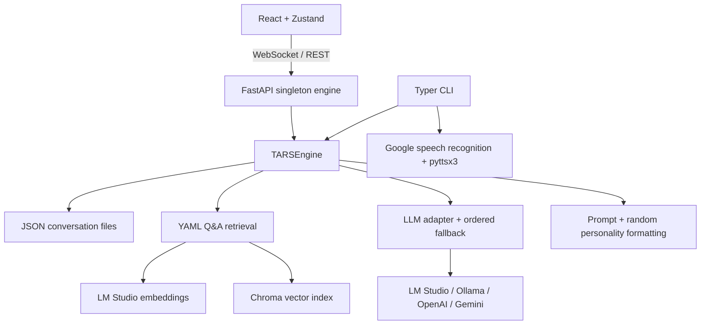
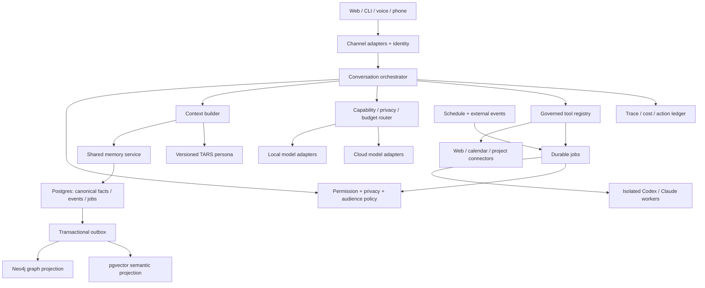

# TARS personal intelligence: codebase assessment and implementation plan

Prepared 2026-11-21. Baseline commit: `33f57fa`. Status: proposed architecture; implementation has not begun. This document describes the migration from the existing chatbot to the owner's persistent personal assistant. The six operational context files live in `context/`.

## 1. What we are building

TARS should be one continuous personal intelligence across text, voice, phone calls, routines, and project work. It should understand the owner's relationships and priorities, remember useful information across sessions, research current information, and delegate bounded programming tasks to Codex or Claude Code. Its default character is practical, loyal, concise, and dryly sarcastic. Its delivery changes with the audience: respectful with parents, playful with consenting friends, and professional with work contacts.

The central design is **persistent identity + shared memory + governed tools + interchangeable models**. A model is a reasoning provider, not the owner of TARS's identity or memory. Switching models can preserve context and behavioral rules; it cannot guarantee identical wording, capability, or personality fidelity. Those need evaluations.

Fine-tuning and memory solve different problems. Fine-tuning changes a particular model's behavior. Memory stores changing facts, relationships, commitments, and experiences outside model weights. A LoRA adapter cannot simply be applied to unrelated cloud models. A versioned personality specification, curated examples, and shared evaluations are the portable layer.

## 2. Audit scope and evidence

Reviewed the application-owned backend, API/CLI entry points, provider adapters, retrieval and persistence paths, voice code, personality code, frontend chat/state/settings/status flows, build configuration, test code, dataset converter and training configuration, README and historical `Prompt.txt`. Enumerated assets and runtime files; parsed dataset counts and conversation metadata without reproducing private transcript contents. Third-party dependencies, generated UI primitives, image assets, and binary vector indexes were not exhaustively audited. This is an architectural and behavioral review, not a penetration test or a claim that every runtime path was exercised.

No existing `AGENTS.md` was present in the initial inventory. The supplied `Six-File+Context+Methodology` arrived during the review; its six templates are now instantiated in root `context/`, with root agent entry points. The supplied methodology remains reference material.

Existing uncommitted conversation files and vector database changes were present before this work. They are user data and must be preserved. No live model requests, real calls, training jobs, or deployments were performed.

### Actual current architecture



### Component assessment

| Area and source | Implemented behavior | Implication |
| --- | --- | --- |
| `src/core/tars_engine.py` | Coordinates history, RAG, model generation, special commands, personality | Good migration seam; no planner, tool execution, contact policy, or durable task runtime |
| `src/ai/llm_handler.py` | Four providers; ordered failure fallback; does not restart a stream after output begins | Retain interface idea, add async operations, capabilities, usage, routing policy, cancellation, and typed tool events |
| `src/core/memory_store.py` | In-memory conversations saved as JSON; default cap 50 messages; engine requests 20 messages then removes current input | Recent chat context, not personal long-term memory; older messages are trimmed on writes |
| `src/ai/rag_system.py` | YAML Q&A ingestion, semantic retrieval, topic filtering, relevance cutoff | Useful knowledge retrieval prototype; no temporal relationship graph or personal memory extraction |
| `src/ai/embeddings.py` | Embeddings always use LM Studio's OpenAI-compatible endpoint; Nomic query/document prefixes; dimension check | Chat provider switching does not make embeddings independent; preserve index/model compatibility |
| `src/personality/response_generator.py` | Random prefixes/suffixes and cue-light text | Cannot reliably respect audience, emotional context, or code formatting |
| `src/utils/config.py` | Environment configuration and a restrained factual system prompt | A useful base; settings are mutable global process state |
| `src/voice/voice_interface.py` | Sequential microphone capture, Google transcription, local pyttsx3 playback | Neither fully offline nor interruptible duplex conversation; no telephony |
| `src/interfaces/api.py` | REST, SSE, WebSocket, history, settings, RAG management | Missing identity/ownership enforcement and operational controls needed for remote access |
| `frontend/src/services/tarsApi.ts`, `hooks/useTarsChat.ts` | Streaming chat with REST fallback and conversation IDs | Retain transport separation; add correlated events, cancellation, error handling, reconnection control |
| `frontend/src/store/tarsStore.ts` | Browser-persisted saved sessions and settings | Separate browser/backend histories can diverge; active messages/session ID are not in persisted subset |
| `finetuning/` | Format conversion and training YAML | Preparation only: no trainer, checkpoint, adapter loading path, or training evaluation evidence found |
| `app.py`, `src/index.py` | FastAPI hosting entry points | Hosting adapters do not supply persistent workers, durable storage, or phone availability |

### Dataset findings

There are 17 YAML dataset files, 526 parsed entries, and 407 unique exact question/answer pairs: 119 entries duplicate an existing pair. Counts were derived from content, not filename ranges. The converter randomly splits entries without deduplicating them first, so duplicates can leak across training and evaluation splits. Near-duplicate questions require a separate similarity review.

The datasets mix character dialogue with generated science explanations. Separate these into reviewed style examples and sourced knowledge. Fictional capabilities and unverified scientific claims should not become personal facts or authoritative references. There are 25 JSON conversation files containing 119 stored messages in the current snapshot. This does not imply complete history, because the store trims messages.

### Findings to resolve before adding autonomy

| Priority | Finding and evidence | Required change |
| --- | --- | --- |
| P0 before remote exposure | API has no authentication or conversation ownership; settings/history/RAG endpoints are unrestricted. CORS is wildcard; server defaults to all interfaces. | Private default, authenticated owner/device access, per-resource authorization, explicit origins, rate and payload limits |
| P0 before private cloud use | Fallback can send the prompt/history to a cloud provider when credentials exist, without a data-disclosure policy. | Apply privacy and provider allowlists before selecting any primary or fallback model |
| P0 before external actions | No permission boundary, action ledger, idempotency, or approval scopes | Enforce tools in code, outside prompts, before enabling calls/messages/code execution |
| P1 | Sync provider calls and retrieval run within async API paths, potentially blocking unrelated clients. | Async adapters or bounded thread offload, explicit deadlines, cancellation, backpressure |
| P1 | Global active conversation and global settings persist across clients; JSON writes have no transaction/locking strategy. | Explicit principal/session IDs, database transactions and per-session turn serialization |
| P1 | Legacy conversation IDs are `conv_...`; API request/query models accept UUID only. | Migration map to UUIDs while retaining original IDs and import provenance |
| P1 | Settings GET returns fixed extended values; PUT echoes extended values but does not apply/persist them. Frontend only syncs three basic sliders. | Persist supported settings, wire semantics, disable unsupported controls |
| P1 | SSE emits raw token text, without JSON escaping, conversation ID event, or robust multiline framing. WS handles disconnect but not general generation failures. | Typed event envelope and terminal error/cancel states shared by transports |
| P1 | Frontend stream state is one buffer and updates the last message; no request correlation. | Request/turn/message IDs, prevent or isolate concurrent turns, route late chunks correctly |
| P1 | WebSocket `disconnect()` triggers the close handler that schedules reconnect; timers are not canceled. | Deliberate-close flag and cleanup of pending reconnect timers |
| P1 | Browser mic toggle is UI state only; RAG/LLM indicators are fixed, CPU is simulated, response confidence/source labels are hard-coded. | Real capabilities/metrics and evidence, with clear unavailable states |
| P1 | Special-command substring/regex shortcuts can hijack ordinary questions and bypass message storage. | Explicit commands or narrowly defined intents, with every turn recorded |
| P1 | `POST /api/rag/index` accepts a server filesystem directory from the caller. | Restrict admin ingestion to approved roots and validated import jobs |
| P1 | Conversations and Chroma files are tracked in Git; logs can contain message content. | Separate private runtime storage from source; review any published history before a future cleanup |
| P2 | Embeddings/RAG docstrings mention sentence-transformers, although runtime uses LM Studio. `loaded_datasets` counts newly indexed IDs in the process. | Accurate documentation and distinct file/document/index metrics |
| P2 | `convert_datasets()` imports `..utils.config` from `finetuning.scripts`, which does not resolve to `src.utils`; direct script execution also lacks package context. | Repair entrypoint/import; validate formats and ratios; deduplicate before splitting |
| P2 | Broad dependency lower bounds and legacy Google SDK; TypeScript strictness disabled | Reproducible dependency baseline, supported SDK migration, incremental type checking |

`Prompt.txt` is historical prose, not an implementation specification: claims about LangChain, local Whisper, full duplex, wake words and Three.js are not supported by the reviewed implementation/dependencies. README claims also need tightening. Source behavior takes precedence.

### Verification performed

| Check | Result on 2026-11-21 |
| --- | --- |
| Existing backend `python -m pytest tests -q` | 3 passed; Pydantic/Chroma deprecation warnings. Initial sandbox run stalled in Python's Windows socket initialization; the approved outside-sandbox rerun passed in 2.72 seconds. |
| Frontend `npm run build` | Passed; stale Browserslist data and bundle-size warnings; main JS approximately 669 kB minified |
| Frontend `npm run test` | 1 passed, but it only asserts `true` and provides no feature coverage |
| Frontend `npm run lint` | Failed: 3 errors, 9 warnings; errors in `ui/command.tsx`, `ui/textarea.tsx`, and `tailwind.config.ts` |
| Live model/voice/phone | Not tested; existing mocked tests do not demonstrate these capabilities |

## 3. Proposed target architecture

Use a modular Python application first, with separate long-running worker processes where needed. Retain React/Vite and FastAPI. Avoid a distributed microservice rewrite. Introduce durable storage, authorization, and typed contracts before autonomy.



### Recommended technology choices

| Layer | Recommendation | Why / alternative |
| --- | --- | --- |
| UI/API | Keep React, TypeScript, Tailwind and FastAPI | Existing investment is reusable; this goal does not require changing frameworks |
| Primary store | PostgreSQL plus migrations | Transactions for conversations, facts, policies, jobs and outbox; SQLite is acceptable for an isolated prototype but is not the proposed concurrent call/task target |
| Relationship memory | Neo4j projection behind a memory service | Explicit person/project relationships and graph inspection; introduce after the canonical fact model to avoid three independent truths |
| Semantic retrieval | pgvector target; retain Chroma until migration is validated | Consolidates vector search with primary metadata; separate embeddings by model/version/dimension |
| Durable work | Postgres job table/outbox initially; separate worker with leases | Simple restartable jobs; consider a workflow engine only if durable branching and operational needs justify it |
| Models | Explicit provider adapters with capability registry | Local LM Studio/Ollama and cloud providers share contracts without assuming feature parity |
| Voice | Streaming STT → TARS runtime → streaming TTS baseline | Supports interchangeable text models and inspectable tools; native speech-to-speech adapter can be added later |
| Phone media | LiveKit Agents/SIP candidate; Twilio Media Streams alternative | Separate carrier access from conversation intelligence; prove carrier availability before selecting a provider |
| Coding | Codex SDK/CLI worker; Claude Agent SDK worker | Reuse existing coding harnesses behind bounded jobs; do not automate desktop chat windows |
| Deployment | Private local service first; always-on gateway/worker for phone phase | Phone calls must still have a fallback when the development PC sleeps |

These are project design recommendations, not claims that the infrastructure is installed. pgvector provides PostgreSQL vector similarity search; Neo4j represents nodes and relationships. See [pgvector documentation](https://github.com/pgvector/pgvector) and [Neo4j graph concepts](https://neo4j.com/docs/getting-started/appendix/graphdb-concepts/).

### Module boundaries to introduce incrementally

```text
src/
  domain/          # IDs, events, contracts; no provider SDKs
  runtime/         # turn orchestration, context assembly, cancellation
  providers/       # model + embedding adapters, capability registry
  memory/          # fact ingestion, retrieval, correction, graph projection
  personality/     # versioned persona and audience resolver
  policy/          # authorization, disclosure, action budgets
  tools/           # validated tools and external connectors
  jobs/            # durable execution, leases, retries, scheduler
  agents/          # coding worker adapters and artifact results
  voice/           # STT/TTS, audio sessions, interruption
  telephony/       # carrier callbacks, call lifecycle, transfer
  interfaces/      # HTTP/WS/CLI transport adapters
  observability/   # redacted traces, metrics, action audit
```

Keep existing modules working behind adapters during migration. Do not create empty implementations for every future folder at once.

## 4. Shared graph memory

### Distinct kinds of state

| Kind | Examples | Storage / lifetime |
| --- | --- | --- |
| Working context | Current turn, partial transcript, pending tool | Bounded runtime state with durable turn checkpoints |
| Episodic history | Conversation, call, project event | Canonical timestamped events with retention rules |
| Semantic personal facts | Parent relationship, language preference, project ownership | Versioned claims with evidence and validity intervals |
| Procedural preferences | Quiet hours, how to handle friends, review preferences | Explicit owner-controlled policies |
| Knowledge documents | Project files, approved notes, sourced research | Document metadata + chunks + versioned embeddings |
| Personality | Dry humor, respectful parent mode, examples | Versioned persona package; never confused with personal fact extraction |

Proposed canonical tables: `principals`, `contacts`, `contact_addresses`, `projects`, `conversations`, `messages`, `entities`, `claims`, `claim_sources`, `documents`, `chunks`, `preferences`, `persona_versions`, `tasks`, `jobs`, `tool_runs`, `approvals`, `call_sessions`, `notification_deliveries`, `outbox_events`, and `audit_events`. Record owner ID on every owned record. Store timestamps in UTC and display using the configured IANA timezone (initial user context: Asia/Calcutta).

Example graph: `(Owner)-[:PARENT]->(Person)`, `(Owner)-[:FRIEND]->(Person)`, `(Owner)-[:WORKS_ON]->(Project)`, `(Task)-[:BLOCKED_BY]->(Task)`, `(Person)-[:PREFERS_LANGUAGE]->(Language)`. Relationship names must have documented direction. A phone number belongs to a contact address record with verification metadata; it is not proof of the caller's identity.

Each claim needs `id`, `owner_id`, subject, predicate, object/value, `source_event_id`, observed time, valid-from/to, confidence, verification status, sensitivity, allowed audiences, and superseded/retracted state. Confidence is an extraction assessment, not a probability of truth guaranteed by the model. Inferred preferences stay tentative. An owner's explicit correction supersedes a claim without silently deleting its history.

### Write path

1. Persist conversation/call/tool events first with stable IDs.
2. Extract candidate entities and claims through a schema-constrained job.
3. Resolve aliases conservatively; keep ambiguous people separate until resolved.
4. Validate source, type, privacy and contradictions. Never store arbitrary instructions from a web page or caller as owner policy.
5. Commit accepted claims and outbox events in one database transaction.
6. Idempotently project graph edges and vector documents. Track projection version and lag; failed projections can be rebuilt.
7. Offer the owner inspect/correct/forget/export controls. Process deletions across graph, embeddings, caches and eligible source content; document backup expiration separately.

Postgres is the canonical source. Neo4j and semantic indexes are derived views. This avoids conflicting writes across three stores. When a projection lags, fresh policy/critical facts come from canonical records; report degraded retrieval rather than inventing certainty.

### Read path

Resolve principal and audience → apply disclosure filters → retrieve exact preferences and contacts → bounded graph traversal → semantic and keyword retrieval → rerank → assemble a token-budgeted context with source IDs. Filter again before emitting content. Never retrieve all personal information and rely on the model to keep it secret.

Budget system/persona, current request, relevant facts, recent turns, project evidence, and tool results separately. Older turns can become source-linked summaries. Rebuild context for each provider's limits. Returning to a local model should not require importing a cloud chat transcript as the only memory.

### Migration

Back up current JSON and Chroma data first. Import JSON with an old-ID-to-UUID map and content hashes; re-running the import must not duplicate messages. Preserve originals read-only. Import dataset provenance, deduplicate exact pairs, and tag character examples separately from knowledge. Shadow-query old and new retrieval over a fixed evaluation set. Cut over only after counts, ownership, retrieval quality, deletion and restore tests pass. Re-embed when changing embedding models; never mix incompatible vectors because their dimensions happen to match.

## 5. Model routing and personality

Use a normalized request containing principal/session/turn IDs, messages, persona version, memory source references, allowed tools, privacy class, deadline and token/cost budget. Normalize responses into `started`, `text_delta`, `tool_requested`, `tool_result`, `usage`, `completed`, `failed`, and `cancelled` events, with sequence numbers and identifiers. Provider-specific reasoning state must not be treated as portable memory.

Routing order: privacy eligibility → required capabilities → availability/deadline → evaluated quality → budget. A private-only request stays local even if all local models fail. A cloud-permitted research request may escalate to a stronger model. Code implementation becomes a durable coding job. Live phone turns favor tested low-latency models. Model names are deployment configuration, selected through benchmarks rather than frozen into this plan.

Set connect/read/total deadlines and a finite attempt budget. Fallback before output is usually safe for text generation; after output, mark interruption explicitly. Retrying a tool action is different: reconcile execution state and idempotency before repeating any write or call. Record the actual provider/model and fallback reason, not just the configured primary.

Ollama exposes tool calling, but local-model tool reliability must still be evaluated per model ([official tool-calling documentation](https://docs.ollama.com/capabilities/tool-calling)). Migrate the current legacy Gemini adapter using Google's [GenAI SDK migration guide](https://ai.google.dev/gemini-api/docs/migrate).

### Audience-aware persona

| Audience / context | Proposed default | Example |
| --- | --- | --- |
| Owner, ordinary conversation | Dry humor, concise and useful | “Your tests failed. At least they're consistent. Here's the failing assertion.” |
| Mother or father | Respectful, warm, minimal sarcasm | “Hello, I'm TARS, his assistant. He's unavailable right now. Is it urgent, or may I pass on a message?” |
| Friend with approved playful style | Light sarcasm, never humiliating | “He's occupied. Apparently deadlines have become real. Want me to pass something along?” |
| Professional / unknown caller | Clear, polite, neutral | “I'm his assistant. May I take your name, organization, and reason for calling?” |
| Distress, conflict, urgent situation | No jokes; clarify and escalate | “I'll try to alert him now. What should I tell him?” |

Contact-specific overrides beat group defaults; urgent context suppresses humor. Preferred language and pronunciation are explicit contact preferences, not assumptions from names. Trust/disclosure levels are policy, not playful sliders. Rename “honesty” to “directness”; factual honesty is invariant. Remove random text decoration from code, citations, professional replies and speech. Cue lights belong in UI events, not spoken narration.

Start with prompts plus a small curated example set per audience. Build held-out tests before training. Later compare a local adapter against the prompt-only baseline for task success, tone, appropriate restraint and privacy. Do not train on private conversations by default. Split by duplicate/semantic group and source before train/validation/test assignment. Keep personal facts out of weights so corrections and deletions remain possible.

## 6. Tools, research and coding agents

The orchestrator decides what to attempt; a deterministic tool gateway decides what is permitted. Each tool declares input/output schema, permission scope, side effects, network/path bounds, timeout, retry policy, idempotency and audit behavior. MCP may expose connectors, but does not itself supply authorization or sandboxing.

Start with sourced web search/fetch, read-only project access, tasks, and calendar availability. Web results retain URL, retrieval time and quoted evidence. Retrieved pages and repository content are untrusted data. Fetching requires URL/network protections, including private-address and redirect checks. Credentials live in the host's secret store, never in persona prompts or memory embeddings.

| Action | Default policy to implement |
| --- | --- |
| Read approved notes, search public web, draft a plan | Execute within existing scoped grants |
| Edit a project in an isolated checkout | Execute within an owner-requested coding task |
| Send external messages, place calls, modify shared calendars | Require a specific grant or an approval covering recipient/action/arguments |
| Publish, merge, deploy, destructive file operations | Explicit scoped approval unless a previously configured policy covers the exact action |

Coding jobs carry objective, allowed repository/root, baseline revision, acceptance commands, context bundle, deadline, budget and permitted operations. Run Codex/Claude in isolated worktrees or sandboxes with restricted credentials/network. Return changed files, diff, tests, errors and artifact references. Do not grant callers code execution or expose full personal memory to coding agents.

Use a small Node worker if selecting the TypeScript Codex SDK; keep the Python orchestrator behind a job contract. Claude Agent SDK offers an integration path for Claude Code capabilities. Recheck authentication, supported OS/runtime and billing at implementation time. See [Codex SDK](https://developers.openai.com/codex/sdk/) and [Claude Agent SDK](https://code.claude.com/docs/en/agent-sdk/overview). These workers contribute source-linked project outcomes to memory; their vendor sessions are not TARS's canonical memory.

Job states: queued → running → waiting-for-approval → completed/failed/cancelled. Heartbeats, leases, cancellation and retry limits are required. Reconcile an interrupted external operation before retrying; never assume exactly-once delivery from a network API.

## 7. Voice and phone handling

Build browser voice before carrier integration: microphone consent → audio transport → voice activity detection → streaming transcription → runtime → sentence-level speech synthesis. Support interruption, echo handling, silence timeouts, noise, partial transcripts, and a text fallback. Benchmark the owner's actual languages and hardware. Native audio models can later use the same memory/policy/tools contracts.

Proposed targets, not measured performance: median end-of-speech to first audible response below 1.5 seconds, p95 below 3 seconds, and interruption stopping buffered speech within 300 ms. Measure STT, endpointing, retrieval, first token, TTS and transport separately. Slow reasoning/coding runs out of band; acknowledge and offer a follow-up instead of holding a phone turn silently.

### How the number connects

A separate assistant number is the first pilot. To answer calls to the owner's existing number, validate carrier busy/no-answer forwarding to the assistant number, or a supported porting/BYOC arrangement. An LLM API does not automatically control an existing SIM. Country, carrier, number provisioning, caller-ID preservation, calling permissions and recording requirements remain launch decisions; the user's timezone does not establish the phone jurisdiction.

LiveKit supports SIP-based inbound/outbound telephony ([telephony documentation](https://docs.livekit.io/telephony/)). Alternatively Twilio supports bidirectional call audio over WebSockets ([Media Streams](https://www.twilio.com/docs/voice/media-streams)). Choose one initial media path; do not implement both. With Twilio Media Streams, account for the documented audio encoding and buffer/clear/mark protocol ([WebSocket message reference](https://www.twilio.com/docs/voice/media-streams/websocket-messages)).

### Inbound call lifecycle

1. Verify provider callback signatures and deduplicate events by provider call/event ID.
2. Resolve dialed account and normalized caller number. Treat caller ID as a hint; unknown/withheld/forwarded identity remains uncertain.
3. Look up contact policy and owner availability with freshness metadata. Stale calendar data does not justify claiming the owner is definitely busy.
4. Introduce TARS as the owner's AI assistant. Use the appropriate audience style; collect name/reason/urgency.
5. Use only caller-authorized context. Family relationship alone does not authorize disclosure of private projects, location, calendar details, or credentials.
6. Take a message, offer a permitted callback window, or escalate to the owner. Confirm critical names, times and numbers verbally.
7. Transfer or notify through a separate path that cannot forward back into TARS indefinitely. If owner unavailable, acknowledge that and take a message.
8. Persist outcome and agreed tasks, send the owner a concise summary, and optionally propose memory updates. Raw audio recording is off by default for the pilot.

Call states: received → screening → conversing → transferring/message-taken → ended. Include provider errors, hang-up, silence, voicemail and disconnected-media transitions. On AI/media failure, carrier-side fallback should take a message or reach the owner without depending on the same failed worker.

### Outbound and proactive calls

First allow only calls to the owner under explicitly configured rules: urgent family message, imminent owner-approved deadline, or a reminder the owner requested. Store destination allowlist, quiet hours, exception rules, reason, cooldown, maximum attempts, maximum duration, and daily spend cap. Lower-urgency items go to a notification/digest. Deduplicate reminders; retrying after restart must not redial blindly. Expand to third parties only through scoped permissions and tested professional scripts.

Before real phone launch, verify provider eligibility, jurisdiction-specific disclosure/recording requirements and fees for the actual country/carrier. This plan makes no legal determination and assumes no number is currently provisioned.

## 8. Routines and proactive intelligence

Begin with explicit user routines: morning agenda, project review, follow-up reminders, and end-of-day summary. Store trigger, timezone, data dependencies, condition, action, disclosure scope, quiet hours, cooldown and expiration. Calendar and project events update a durable scheduler; the model explains relevant events rather than polling continuously and inventing reasons to interrupt.

Use a notification ladder: dashboard → push/digest → owner phone call for configured urgency. Every proactive action needs an explainable trigger (“You asked me to call if this deadline was within 30 minutes and the task remained open”). Owner can mute, snooze, revoke or disable all outbound activity immediately. Check current policy at execution time, not only when a job is enqueued.

## 9. Phase-by-phase delivery

Effort ranges are planning estimates for one developer familiar with the stack, not commitments. Hardware, carrier approval, language quality and provider access can change them. Advance by acceptance gates, not calendar dates.

| Phase | Deliverable and rough effort | Dependencies | Exit gate |
| --- | --- | --- | --- |
| 0 — Baseline and design | This audit, context system, first implementation spec; completed planning | Repository access | Findings and roadmap are traceable; existing data preserved |
| 1 — Reliable private chat | Auth/session ownership, typed streaming, persistent settings, async isolation, honest UI; 1–2 weeks | Phase 0 | Two concurrent sessions cannot mix history/output; local-only policy never calls cloud; stream failure/cancel recovers; baseline checks pass |
| 2 — Shared personal memory | Canonical events/facts, graph/semantic projections, inspect/correct/forget UI, imports; 2–3 weeks | Phase 1 | Recall survives restart and model switch; corrected/deleted facts are absent from retrieval; unauthorized audience gets no private facts; backup restore succeeds |
| 3 — Useful assistant tools | Sourced web research, projects/tasks, first calendar read integration, tool policy; 1–2 weeks | Phase 2 | Sources visible; malicious retrieved instructions cannot execute tools; action grants and failures audited |
| 4 — Coding delegation | One coding adapter first, isolated jobs, diff/test artifacts; 1–2 weeks | Phase 3 | TARS completes a bounded repo task, reports actual tests, supports cancellation, and cannot edit outside permitted roots |
| 5 — Natural voice | Browser audio, streaming STT/TTS, interruption and audience styles; 1–2 weeks | Phases 1–3 | Timed voice tests meet agreed latency, interruption and transcription targets on actual hardware |
| 6 — Phone assistant pilot | Carrier sandbox, inbound test number, contact screening, transfer/message fallback; 2–3 weeks plus provisioning | Phases 2, 3, 5 | Controlled parent/friend/professional/unknown scenarios pass, duplicate callbacks do not duplicate actions, outage fallback works |
| 7 — Proactive routines | Durable schedules, owner notifications/calls, quiet hours and quotas; 1–2 weeks | Phase 3; Phase 6 for calls | Restart/misfire tests do not spam; every interruption has an approved trigger; emergency stop works |
| 8 — Optimize and personalize | Cross-model evaluations, optional local fine-tune, operational hardening; ongoing | Measured baseline from earlier phases | Tuning measurably improves style without degrading factuality/tool/privacy tests |

Early payoff: phases 1–3 produce a useful personal assistant before phone work. An initial estimate is roughly 9–16 focused development weeks for phases 1–7, excluding provisioning and later tuning. Voice work can start after its dependencies while coding delegation remains optional for the phone milestone.

### Evaluation and release gates

- **Memory:** owner-authored fact/relationship questions; expected source IDs; contradictory and expired claims; cross-model continuity; deletion across all projections. Start with 50 scenarios and target at least 90% supported correct recall, with zero known unauthorized disclosures in the release suite.
- **Personality:** at least 10 scenarios per audience, including distress and criticism; owner reviews tone. Require all urgent/professional cases to avoid inappropriate sarcasm before phone release.
- **Tools:** schema rejection, revoked grants, prompt injection, path/network escape, duplicate actions, timeout and retry reconciliation. All permission-denial tests must pass.
- **Voice/calls:** interruption, background noise, names, numbers, mixed languages, withheld identity, busy/unavailable owner, voicemail, transfer loops and provider downtime. Report median/p95 latency rather than one successful demo.
- **Coding:** correctness against task acceptance, bounded filesystem access, real test evidence, preserved user changes, canceled jobs and restart behavior.
- **Operations:** restore from backup, projection rebuild, lost worker lease, database outage, budget exhaustion and kill switch. Define call availability targets after the pilot, with carrier fallback tested independently.

### Cost and hosting decisions

Track costs per turn, job and call. Monthly cost is infrastructure + number rental + inbound/outbound minutes + STT minutes + TTS usage + model input/output usage + embeddings + storage. Do not assume a consumer chat subscription includes programmatic calling or coding/API usage. Gather current quotes after country/provider selection and set per-call/per-day caps before enabling outbound activity.

Do not buy hardware yet. First inventory CPU/RAM/GPU/VRAM, measure local tokens/second and speech latency, and compare the actual privacy/quality requirements. For always-on operation, use an available local host or a small hosted gateway with private connectivity to local inference; if that connection fails, obey the cloud-disclosure policy and use a safe call fallback. Database ports stay private, secrets stay server-side, and long-lived media/jobs require a suitable persistent runtime.

## 10. Immediate next work and unresolved decisions

Start with `context/specs/01-reliable-chat-foundation.md`; do not start by fine-tuning or buying a phone number. The ordered units are in `context/specs/00-build-plan.md`.

Owner decisions needed before dependent phases: available hardware; acceptable monthly spend; which memories may leave the machine; preferred spoken languages and voice; actual phone country/carrier; separate number versus forwarding; calendar/task services; whether the assistant must operate when the PC is off; approved contact groups, quiet hours and urgent escalation rules. These do not block foundation work.

Implementation will update the six context files after each meaningful unit, recording evidence and remaining limitations. Documentation of a planned capability is never evidence that the capability exists.
